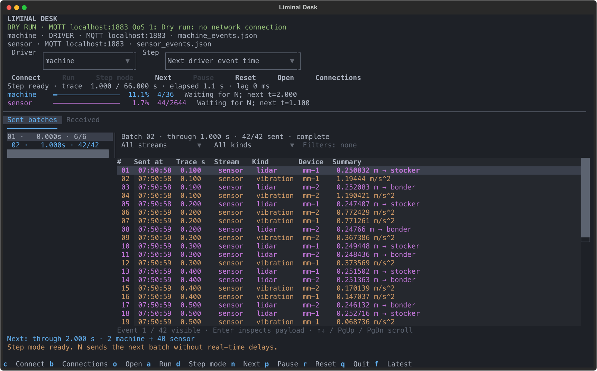

# Liminal Desk CLI

A terminal trace player for Liminal, with coordinated MQTT/TCP replay, a One Dark
Textual interface, and message-by-message inspection.



## Setup

Python 3.10 or newer. From the repository root:

```sh
python3 -m venv .venv
source .venv/bin/activate
python -m pip install -r requirements.txt
python -m liminal_desk_cli
```

If you already use the repository's `venv`, activate it with
`source venv/bin/activate` and install the updated requirements there. No application
installation or `PYTHONPATH` change is required. Textual is required for the UI;
Paho is needed only for MQTT. Offline `--help` and `--check` need neither.

## Launch

```sh
# MQTT: localhost:1883
python -m liminal_desk_cli
# TCP: machine input 8080, sensor input 8081
python -m liminal_desk_cli --transport tcp --host 127.0.0.1
# Mixed MQTT / TCP
python -m liminal_desk_cli --sensor-transport tcp --sensor-port 9002
# Explore without sending anything to the network
python -m liminal_desk_cli --dry-run
# Validate files without opening the UI
python -m liminal_desk_cli --check
# Custom traces, in stream order
python -m liminal_desk_cli path/to/first.json path/to/second.json
```

Start your broker or Liminal TCP receiver separately. The default inputs are the
same JSON traces in `examples/shop_floor/`: 36 machine messages and 2,644 sensor
messages over 66 seconds. See [TCP setup](docs/tcp.md) and the
[example receiver](examples/shop_floor/liminal_tcp_inputs.toml).

## Workspace

- **Driver and step selectors:** first stream drives stepping by default. Choose
  next driver event time, next timestamp across both streams, or one message.
- **Sent batches:** numbered, scrollable, coloured event rows; all batches in the
  current run remain available. Filters preserve original event numbers.
- **Received:** separate MQTT subscription traffic or TCP replies. Switching tabs
  does not pause replay, clear events, or move the selected row.
- **Payload inspector:** press Enter on a row to inspect the actual outgoing JSON,
  rebased timestamp, destination, and transport completion status.
- **Open trace:** directory browser, editable path, validation preview, recent
  files, and remembered folder. Invalid files never replace the current trace.
- **Connections:** edit per-stream MQTT/TCP endpoints and MQTT options.

The palette matches the [One Dark terminal profile](https://github.com/nathanbuchar/atom-one-dark-terminal):
background `#1E2127`, text `#ABB2BF`, selection `#3A3F4B`, machine blue `#61AFEF`,
vibration amber `#D19A66`, LiDAR purple `#C678DD`. True-colour terminal support
is needed for exact colours. `NO_COLOR` is respected.

## Controls

| Key | Action |
|---|---|
| C | Connect/disconnect streams |
| B | Connection settings |
| O / L | Open a trace file |
| A | Start automatic replay |
| D, then N | Arm step mode, then send the next batch |
| P / Space | Pause/resume |
| R | Reset with fresh timestamps on the next run |
| Enter | Inspect selected event or select a batch |
| Escape | Close inspector or cancel a dialog |
| Arrows, Page Up/Down, Ctrl+Home/End | Navigate the focused table |
| V / Shift+V / F | Previous / next / latest batch |
| E | Focus the sent-event table |
| Q | Disconnect and quit |

Mouse selection and scrolling are supported. Connect with C and wait for readiness
before A or D. In a dry run, C enables the simulated connection. A terminal of
120 columns by 36 rows or larger is recommended; narrow windows hide the batch
sidebar and mouse control row, keeping keyboard shortcuts and tables available.

Source files are never rewritten. Outgoing timestamps use a common new Unix origin
for each run. TCP completion means local socket write; MQTT QoS 1 completion means
broker acknowledgment. Neither proves downstream processing.

## Documentation and development

- [Usage and timing](docs/usage.md)
- [MQTT/TCP configuration](docs/tcp.md)
- [Trace format](docs/trace_format.md)
- [Architecture](docs/architecture.md)
- [Testing](docs/testing.md)
- [Shop-floor scenario](docs/shop_floor_scenario.md)
- [Interactive presentation](docs/shop_floor_scenarios.html)

```sh
python -m unittest discover -v
```

Application code lives in `liminal_desk_cli/`, tests in `tests/`, examples in
`examples/`, and documentation in `docs/`. The current launcher loads two traces;
the driver and stepping logic are independent of shop-floor event names or rates.
The supplied streams retain their familiar machine/sensor labels. Arbitrary stream
creation is not part of this release.

See [LICENSE](LICENSE) for licensing terms.
