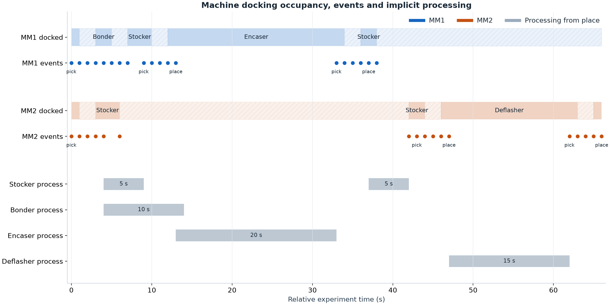
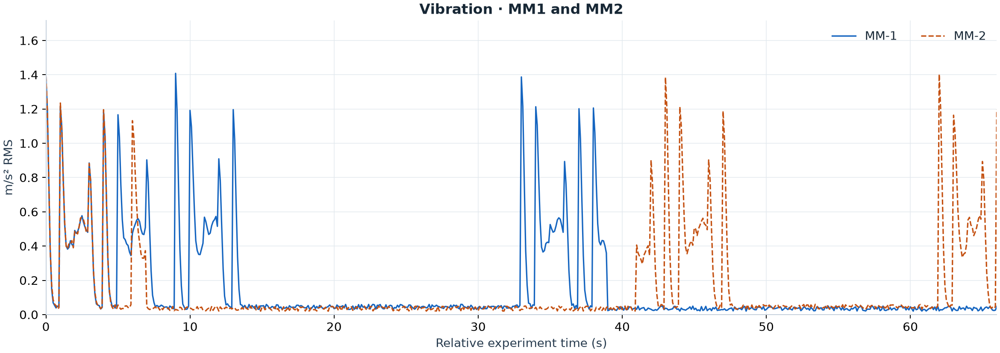
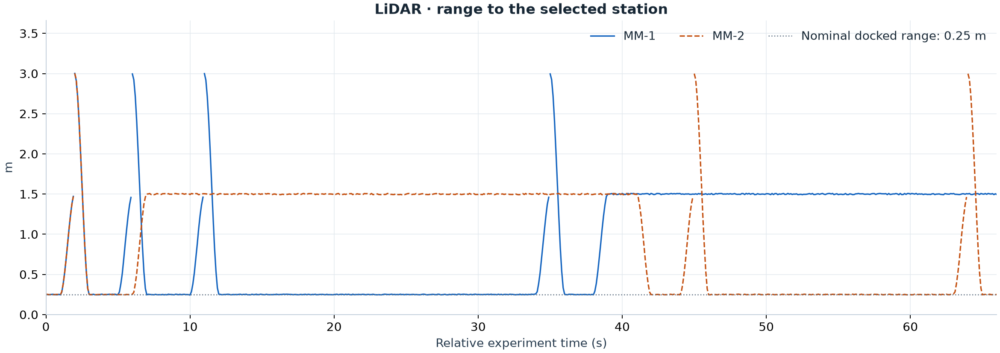

# Shop-floor scenario: machine events and sensor observations

This experiment models two mobile manipulators (MM1 and MM2) transferring trays
between Stocker, Bonder, Encaser and Deflasher. The aim is to study how discrete
robot operations relate to continuously sampled sensors and exclusive docking
ownership. The observation window is **t=0–66 seconds, including both endpoints**.

Open [the interactive presentation](shop_floor_scenarios.html) for synchronized
hover readouts, a shared time slider, event stepping, playback and time-range
zoom. It works offline with the current JSON traces embedded. Replacement
`machine_events.json` and `sensor_events.json` files can be loaded through the
page's file controls. The presentation does not publish to MQTT.

## Inputs and initial state

The source files are the corrected [machine trace](../examples/shop_floor/machine_events.json) and
[sensor trace](../examples/shop_floor/sensor_events.json), using Desk's version-1 `steps` format. A
`delay` advances relative time; a `send` contains a payload with a Unix timestamp.
The presentation derives relative offsets from delays and checks that those
offsets agree with the payload timestamps. Every plotted magnitude comes from
the sensor JSON; no plotting-time sensor synthesis or smoothing is applied.

There are **36 machine events** and **2,644 sensor events**. For each MM,
vibration and LiDAR each have **661 samples at 10 Hz**: t=0.0, 0.1, …, 66.0 s.
MM1 is blue; MM2 is orange throughout. Sensor lines additionally distinguish
MM1 with a solid line and MM2 with a dashed line.

Initially MM1 is docked at Stocker, MM2 at Bonder, and neither holds a tray before
its first pick. Stocker contains Dies and Bonder contains independently available
BondedDies. These are two initial trays. We omit tray identities and explicit
manufacturing-machine events to focus on MM operations.

## Machine timeline and workflow

Colored bars show docking occupancy; pale hatched intervals mean the MM is
undocked. Circles mark machine events. Grey bars show assumed manufacturing
processing, which is separate from docking occupancy. In the interactive chart,
the undocked intervals are further split into departure, travel, waiting and
the inferred local approach.

| Phase | Time | What happens |
|---|---|---|
| Concurrent exchange | 0–4 s | MM1 takes Dies from Stocker to Bonder; MM2 takes BondedDies from Bonder to Stocker. |
| Feed Encaser | 5–13 s | MM1 returns to Stocker, picks BondedDies at t=9 and places them at Encaser at t=13. |
| Encasing and return | 13–38 s | MM1 remains docked through encasing, picks EncasedDies at t=33, deposits them at Stocker at t=37 and undocks at t=38. |
| Feed Deflasher | 42–47 s | MM2 docks at Stocker, picks EncasedDies at t=43 and deposits them at Deflasher at t=47. |
| Deflashing and return | 47–66 s | MM2 picks DeflashedDies at t=62, returns to Stocker and places them at t=66. |

Processing time starts at **place**, not at dock. A dependent pick must satisfy
`pick_time >= place_time + processing_duration`.

| Station / input | Place | Duration | Ready | Dependent pick |
|---|---:|---:|---:|---:|
| Stocker / BondedDies | 4 | 5 s | 9 | 9 |
| Bonder / Dies | 4 | 10 s | 14 | Outside this trace |
| Encaser / BondedDies | 13 | 20 s | 33 | 33 |
| Stocker / EncasedDies | 37 | 5 s | 42 | 43 |
| Deflasher / EncasedDies | 47 | 15 s | 62 | 62 |
| Stocker / DeflashedDies | 66 | 5 s | 71 | Outside this trace |

Processing can continue while an MM is docked or after it leaves. Docking
occupancy is exclusive. The Stocker intervals are MM1 [0,1), MM2 [3,6), MM1
[7,10), MM1 [36,38), MM2 [42,44), and MM2 from 65 through the end of the excerpt.
Bonder is occupied by MM2 [0,1) and MM1 [3,5); Encaser by MM1 [12,34); Deflasher
by MM2 [46,63). These docking intervals do not conflict.

## Vibration

Vibration values are synthetic scalar RMS acceleration in **m/s²**, conceptually
a 100 ms feature of gravity-removed acceleration. We do not generate an underlying
high-rate waveform or reproduce a particular commercial sensor.

| State | Baseline (m/s² RMS) |
|---|---:|
| Docked and stationary | 0.045 |
| Undocked and parked | 0.035 |
| Moving | 0.52 |
| Departing | 0.38 |
| Inferred local approach | 0.35 |

Readings include bounded uniform noise ±0.015 m/s². Movement states also include
a 1.3 Hz modulation of amplitude 0.045 m/s². Each pick/place/dock/undock adds a
short causal pulse, with amplitude 1.35/1.15/0.85/0.80 m/s² respectively:

`pulse(t) = A * exp(-0.5 * ((t - event_time) / 0.18)^2)`

The pulse is active for 0–0.600 s after the operation, including the endpoint
deterministically using integer milliseconds. Overlapping pulses use the maximum.
Pulses do not start before their events. Long processing periods leave the
stationary MM near its low baseline: we do not simulate station-machine
vibration transferred to the robot. The t=66 place pulse starts at the final
sample; its decay is outside the requested window. Values are illustrative,
not calibrated industrial measurements or validated fault thresholds.

## LiDAR

LiDAR is a scalar range in **metres to an explicitly named target station**,
rather than a point cloud or distance to the nearest obstacle.

- Docked, picking or placing: current station, nominal distance 0.25 m.
- Departing: source station, range increases from 0.25 to 1.50 m over one second.
- Explicit move: destination station, range decreases from 3.00 to 0.25 m over
  the one second ending at dock.
- Waiting outside: last source station, approximately 1.50 m.

Interpolation uses `S(u)=3u²−2u³` for u in [0,1]. Departure is
`0.25+1.25*S(u)`; explicit approach is `0.25+2.75*(1-S(u))`. Noise is bounded
uniform ±0.004 m while docked and ±0.008 m elsewhere. The original synthetic
noise seed is 20261112. A tolerance should be used instead of exact equality
with 0.25 m.

Both static and interactive LiDAR plots break their lines at target changes.
Switching from the source to a different destination can cause a large numerical
jump, since the two values describe different stations. It is not a jump in the
robot's physical position. Hover readouts name the target.

MM2 departs Stocker during [6,7), waits during [7,41), then has an **inferred local
approach during [41,42)** before the prescribed dock at t=42. The approach uses
1.50→0.25 m because there is no explicit move event there. No machine events were
inserted. MM1 departs Stocker during [38,39) and stays parked outside through t=66.
The waiting-area model assumes space for other robots to use the station.

## Coordinated replay and manual stepping

The CLI reads both traces, merges their delay-derived schedules and uses a shared
monotonic replay clock. Machine payloads go to `liminal/machine_data`; sensors to
`liminal/sensor_data`. Equal-time machine events precede sensors; the sensor
trace's varied interleaving is preserved. Time never goes backwards, though
simultaneous observations share timestamps.

For each run, the CLI replaces outgoing `timestamp_ms` in memory with the new
Unix replay origin plus the event offset. Source files do not change. Automatic
playback lasts about 66 seconds, plus setup/transmission overhead and pauses.
Pausing freezes simulation time. Step mode advances without real-time waits:
N sends through the next machine timestamp, including the sensor observations
since the previous boundary. Simultaneous machine events form one step. A jump
from t=13 to t=33 is a 20-second slice, not a one-second step.

The interactive presentation has its own slider, hover cursor and previous/next
event-time controls. Those inspect the data only and do not exercise MQTT or
Liminal. Its default sensor readout selects the nearest 100 ms sample rather
than inventing an interpolated magnitude. Loading replacement traces updates
the graphs and event table, but the explanatory notes still describe this agreed
scenario and should be revised if the experiment changes.

## Interpreting the current fusion output

The current `shop_floor.toml` uses `latest_by_input`, retaining each latest
machine event and updating its fused snapshot when sensor messages arrive.
It sets `out_of_sync` when either absolute sensor timestamp difference from the
retained machine timestamp is greater than 50 ms. With 100 ms sampling, a later
sensor reading can therefore legitimately produce a flagged snapshot even when
the publisher is synchronized.

In the inspected run.log there were 36 input machine messages, 2,644 input sensor
messages, 36 unflagged snapshots matching the same-time observations, and 1,926
flagged snapshots as retained events were combined with subsequent sensors.
These are observations from that run, not performance guarantees. Retaining the
compared timestamps and age differences makes the flags easier to interpret;
raising the threshold alone does not change the continuous snapshot behavior.
The existing output name `vibration_g` is misleading: these inputs use m/s².

## Scope and validation

The supplied trace has complete 100 ms sensor grids, consistent delay/payload
timestamp offsets, legal tray pick/place order, exclusive logical docking
ownership and respected implicit processing waits. The charts read the corrected
JSON values directly. They do not establish floor-plan collision freedom,
actual sensor calibration, real manufacturing completion, or exactly-once MQTT
processing. Network delivery can vary between subscriber connections.

Files: `shop_floor_scenarios.html` (offline interactive presentation),
`shop_floor_scenario.md` (these notes), and `assets/` (three static PNG figures).
Prepared 12 November 2026.
